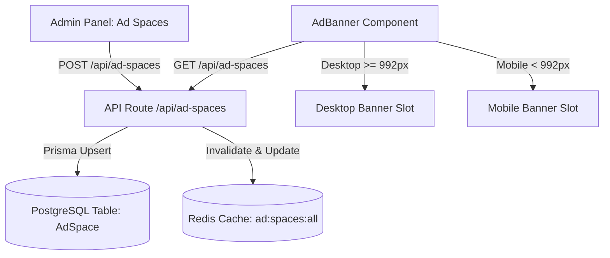

# Ad Spaces Architecture & Implementation Guide (PostgreSQL + Redis)

## Overview
The **Ad Spaces** feature allows administrators to manage and deploy custom responsive advertisements directly across the website from the Admin Panel, matching the exact reference UI design.

Advertisements are split into **Desktop Banners** (for screen widths $\ge 992\text{px}$) and **Mobile Banners** (for screen widths $< 992\text{px}$) with support for both raw HTML/script embed codes (e.g., Google AdSense, WhatsApp links, affiliate banners) and direct visual banners (custom banner image + destination URL).

All ad space configurations are stored in **PostgreSQL** via Prisma (`AdSpace` table) and cached in **Redis** (`ad:spaces:all`) for sub-millisecond public page rendering.

---

## Supported Ad Spaces
The system provides 11 ad placements:

| Key | Label | Placement Description |
|---|---|---|
| `header` | Header | Top header banner above main content |
| `index_top` | Index (Top) | Top of homepage content column |
| `index_bottom` | Index (Bottom) | Bottom of homepage content column |
| `post_details_top` | Post Details (Top) | Top of single article detail view |
| `post_details_bottom` | Post Details (Bottom) | Bottom of single article detail view |
| `posts_top` | Posts (Top) | Top of category & all-blogs post lists |
| `posts_bottom` | Posts (Bottom) | Bottom of category & all-blogs post lists |
| `sidebar_1` | Sidebar-1 | Right rail sidebar after Trending News |
| `sidebar_2` | Sidebar-2 | Right rail sidebar bottom |
| `in_article_1` | In-Article-1 | Article body after paragraph 2 or 3 |
| `in_article_2` | In-Article-2 | Article body after paragraph 5 or 6 |

---

## Architecture & Data Flow



### Zero-Layout Shift & Clean Fallback
- When no ad code or banner is configured for a space, the `<AdBanner />` component renders `null`.
- No empty gaps, broken images, or blank boxes appear on the website if a space is inactive.

---

## Database Schema (Prisma)

```prisma
model AdSpace {
  id            String   @id @default(cuid())
  spaceKey      String   @unique
  name          String
  language      String   @default("English")
  desktopWidth  String   @default("800")
  desktopHeight String   @default("130")
  desktopAdCode String?  @db.Text
  desktopAdUrl  String?
  desktopImgUrl String?
  mobileWidth   String   @default("300")
  mobileHeight  String   @default("250")
  mobileAdCode  String?  @db.Text
  mobileAdUrl   String?
  mobileImgUrl  String?
  isActive      Boolean  @default(true)
  createdAt     DateTime @default(now())
  updatedAt     DateTime @updatedAt
}
```

---

## Applying Database Schema

```bash
# Push schema to PostgreSQL database
npx prisma db push

# Generate updated Prisma client
npx prisma generate
```
